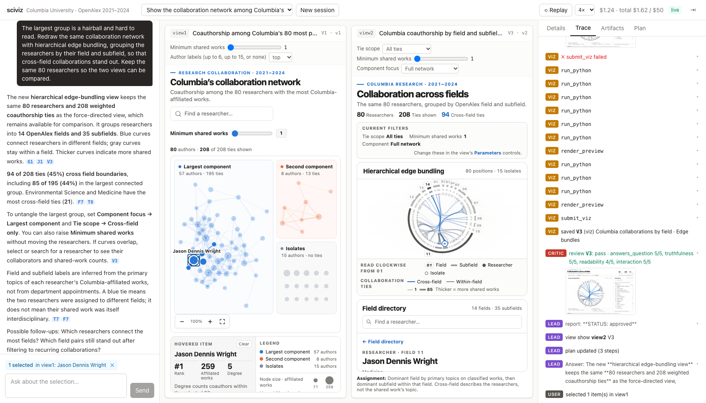
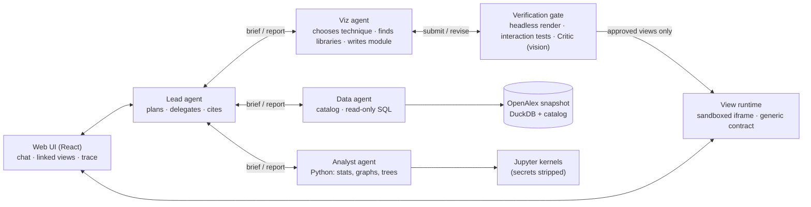
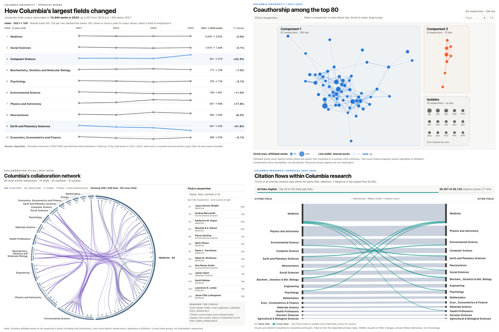

# sciviz: a multi-agent LLM system for interactive scholarly data visualization

sciviz answers natural-language analytical questions about scholarly data with **interactive, linked and
AI-modifiable visualizations**. A Lead agent plans each answer and delegates to specialist agents (Data, Analyst, Viz).
A **verification gate enforced by the harness** decides whether a visualization can be shown. In the web app you can
hover for details, select items, ask follow-up questions about the selection, and have the AI change the views
through parameters, highlights or new code.

The data is an OpenAlex snapshot of **Columbia University's 55,371 works published 2021–2024** (see [docs/DATA.md](docs/DATA.md)).

This repository is Project 1 (tasks T1–T3) of the WHALES Lab coding test.



**Demo video:** [`demo/video/sciviz_demo.mp4`](demo/video/sciviz_demo.mp4). About 5 minutes with narration. It replays recorded sessions.

---

## Contents
1. [Quick start](#quick-start)
2. [What it does (demonstrated outputs)](#what-it-does)
3. [Architecture](#architecture): how agents collaborate, how computation runs, how visualizations are represented and rendered
4. [Generalizability](#generalizability)
5. [Evaluation](#evaluation)
6. [What works, what is incomplete](#status)
7. [Main technical decisions](#decisions)
8. [Repository layout and development docs](#layout)

---

<a id="quick-start"></a>
## 1. Quick start

Requirements: Python ≥ 3.12 with [uv](https://docs.astral.sh/uv/), Node ≥ 20, and internet access (views load
pinned JavaScript libraries from a CDN).

```bash
uv sync
uv run playwright install chromium        # headless browser for the verification gate
(cd frontend && npm install && npm run build)
```

**Data.** Download the processed database `columbia.duckdb` (173 MB) from the GitHub release into `data/`, or rebuild it:
```bash
# rebuild from OpenAlex (needs a free OPENALEX_API_KEY); the published snapshot is from 2026-11-23
python3 -I data_pipeline/fetch_openalex_snapshot.py --out ../snapshot --years 2021-2024
uv run python data_pipeline/build_duckdb.py --snapshot ../snapshot --out data/columbia.duckdb
uv run python data_pipeline/build_catalog.py --db data/columbia.duckdb --semantics catalog/columbia_semantics.yaml --out catalog/columbia.yaml --doc docs/DATA.md
```
For a quick look, `SCIVIZ_DB=catalog/columbia_sample.duckdb` uses the small (3%) sample that is committed to the repo.

**Replay mode (no API key needed).** The recorded sessions in [`recordings/`](recordings/) can be explored exactly as they happened:
- `demo-network-2`: network → edge bundling → highlight → parameter → code edit;
- the 8 evaluation runs.

```bash
SCIVIZ_WORKSPACES=recordings uv run sciviz serve --port 8001     # API + built UI, no key needed
```
Then open http://localhost:8001, pick a session, and press "Replay", or open http://localhost:8001/?session=demo-network-2&replay=1&speed=8.
Use a regular browser such as Chrome or Safari. The views run in sandboxed iframes, which some embedded browser panes block.

**Live mode.**
```bash
cp .env.example .env                      # set OPENAI_API_KEY
uv run sciviz serve --port 8000           # then open http://localhost:8000 and ask a question
uv run sciviz ask "Show the collaboration network of Columbia's 80 most prolific researchers"   # CLI
```

**Tests.**
```bash
uv run pytest -q
```
The unit tests make no LLM calls. They include the no-hardcoding check, the gate's retry → escalate → stop logic, and ledger concurrency.

```bash
uv run python evals/run_eval.py --mode multi     # 4-task evaluation (live; costs about $2-4)
```

<a id="what-it-does"></a>
## 2. What it does

| Requirement | Demonstrated by |
|---|---|
| Standard statistical chart | "How has Columbia's yearly publication output changed across its largest research fields?" → interactive chart with tooltips and parameter controls |
| Network with an algorithmic layout | "…collaboration network among the 80 most prolific researchers… force-directed" → the Viz agent looked up `d3-force`, built a zoomable network, and kept components separate |
| Advanced layout that is more readable | Follow-up: "…redraw with hierarchical edge bundling, grouped by field and subfield…" → a radial bundled view next to the force layout, with linked selection, so cross-field ties are visible at a glance |
| A technique used nowhere else (generality) | "…citation flows between fields… as a Sankey diagram" |
| Follow-ups and modifications (T2) | In session `demo-network-2`: select a researcher, then ask "highlight this researcher's coauthors in both views" (highlight path, 10 s). "Show only the cross-field ties" (parameter path, 15 s). "Color the researchers by their field and add a field legend" (code path: the module is edited, re-verified and hot-swapped, 232 s; the old version stays available for undo and compare). |

Interaction in every view comes from a generic runtime:
- hovering shows details (the dataset record plus the view's own data);
- clicking selects, Shift-click adds to the selection;
- selections are linked across views by dataset id;
- the selection is attached to the next question;
- parameter controls are generated from the view's manifest;
- views have versions, undo and side-by-side compare.

<a id="architecture"></a>
## 3. Architecture



### How the agents collaborate
- **Lead.** A Deep Agents main loop with a todo plan.
  - It decides each next step dynamically: there is no fixed pipeline. Q1 skipped the Analyst; follow-ups reuse existing artifacts.
  - It delegates through the `task` tool with a fixed brief: user question, goal, inputs, definitions, acceptance criteria, output.
  - It never runs code.
  - It finishes with an answer in which every number cites an artifact id.
- **Specialists** run in isolated contexts and return a structured report:
  - **Data:** catalog → SQL → clean tables;
  - **Analyst:** Python: statistics, networks, hierarchies, layouts, findings;
  - **Viz:** technique choice, library discovery, the module, headless previews.
- **Critic.** It is not a sub-agent the Lead could skip. It runs inside the gate, sees only the question, the acceptance criteria, screenshots, automated metrics and data summaries, and returns a structured verdict.
- **Shared workspace.** Every intermediate result is an **artifact** (table, graph, tree, JSON, finding, viz) with its producer, its inputs (lineage) and the code that produced it. A **decision log** keeps definitions consistent across steps and turns. The Lead sees one-line artifact summaries, never raw data.

### How computation runs
- **SQL.** DuckDB, read-only connection, with a timeout.
- **Python.** One persistent Jupyter kernel per (session, agent), with every secret removed from its environment and a prelude (`sql()`, `load()`, `save_table()`, `save_graph()`, `record_finding()`).
- **Visualization checks.** Modules are rendered in headless Chromium (Playwright) by the same runtime the UI uses. Imports are pinned to exact npm versions, and CDN responses are cached on disk.
- **Harness features.**
  - Budgets: a spend ledger with a hard stop, and model-call limits.
  - Retries on model errors.
  - **Model escalation:** after 3 rejected rounds the Viz agent switches to GPT-6.2 Astra.
  - Interrupts: the Lead can ask the user.
  - LangGraph checkpoints.
  - An **event log** for every action, which drives the live trace and **replay mode**.

### How visualizations are represented and rendered
- A visualization is a **viz artifact**: an agent-written ES module plus a manifest (`viz.json`: title, data bindings to artifacts, parameters as JSON Schema, entity types, pinned libraries).
- **Contract.** `render(el, {data, params, width, height, theme, host})` returns `update(params)`, `setSelection(items)`, `highlight(items)` and, optionally, `getState`/`setState`/`destroy`/`pick`. Marks that represent data carry `data-id` + `data-type`, or `data-key` for aggregates.
- **Host runtime.** It turns clicks and hovers on such marks into selections and details, applies default emphasis, and talks to the app through `postMessage`. This is how interaction and linked views are guaranteed without any chart-specific code.
- **Gate.** A view is shown only after:
  - automated checks: render without errors, not blank, marks present, layout metrics;
  - **generic interaction tests:** hover → details; click → selection with ids that exist in the data; visible selection and highlight; multi-item selection and highlight; state round trip; every declared parameter re-renders;
  - the Critic's approval.
- **The UI.** It renders approved views in `sandbox="allow-scripts"` iframes, generates parameter controls from the manifest, and keeps versions, undo and compare.

<a id="generalizability"></a>
## 4. Generalizability

- **No technique-specific prompts, code or workflows.** Prompts describe roles, the module contract, the process and general visualization-design principles. `tests/test_no_hardcoding.py` fails CI if a denylist of technique names appears in prompts or harness code (force-directed, edge bundling, Sankey, chord, treemap, …).
- **Discovery at run time.** The Viz agent can search npm and read package READMEs and type definitions. In the network demo it read the docs of `d3-force` and `d3-zoom` before writing code.
- **Same harness for everything.** The interaction contract, the gate and the controls are generic. Any library or algorithm the agent chooses gets interaction, linking, parameters, verification and replay.
- **Evaluation.** The tasks include a technique used nowhere else in the project (Sankey); see below.

<a id="evaluation"></a>
## 5. Evaluation

Four tasks ([evals/tasks.yaml](evals/tasks.yaml)), one live run each, in two modes. Both modes use identical tools and the same
verification gate:
- **multi**: the system described above (Lead + Data/Analyst/Viz sub-agents);
- **single**: one agent with all the tools and a prompt assembled from the same role prompts. This is an ablation (D40).

Tasks t2 and t4 name a technique. The Sankey diagram in t4 is used nowhere else in the project.

| Task | Mode | Success | Gate rounds (pass / critic revise / auto revise) | Escalated | Time (s) | Cost ($) | Libraries |
|---|---|---|---|---|---:|---:|---|
| t1_trend | multi | ✅ | 1 / 0 / 0 | no | 267 | 0.23 | none |
| t1_trend | single | ✅ | 1 / 0 / 0 | no | 123 | 0.12 | none |
| t2_network | multi | ✅ | 1 / 0 / 0 | no | 460 | 0.43 | none |
| t2_network | single | ✅ | 1 / 0 / 0 | no | 137 | 0.12 | d3@7.9.2 |
| t3_bundling | multi | ✅ | 1 / 0 / 0 | no | 324 | 0.31 | none |
| t3_bundling | single | ✅ | 1 / 0 / 0 | no | 183 | 0.16 | d3-shape@3.2.0 |
| t4_flows | multi | ✅ | 1 / 0 / 0 | no | 289 | 0.26 | d3-sankey@0.12.3 |
| t4_flows | single | ✅ | 1 / 0 / 0 | no | 219 | 0.22 | d3-sankey@0.12.3 |
| **all** | multi | 4/4 | | | 335 avg | 1.23 total | |
| **all** | single | 4/4 | | | 165 avg | 0.61 total | |

Gate rounds are counted as passes / Critic rejections / automated rejections.



**What we learned (honest reading of a small sample):**
- **Both modes solved 4/4 tasks.** Every view passed the gate on its first submission, and Critic scores were similar (4–5 out of 5 per criterion). On the Sankey task, both modes found and used `d3-sankey@0.12.3`.
- **The single agent was about 2× faster** (165 s vs 335 s on average) **and half the cost** ($0.61 vs $1.23 for all four tasks). On short, one-question tasks, delegation overhead does not pay for itself: briefs, reports, and each sub-agent re-reading the catalog and the artifacts.
- **Context isolation is real.** Largest prompt per model call:

  | Agent | Largest prompt (tokens) |
  |---|---:|
  | Lead | 9.6k |
  | Data | 11.4k |
  | Analyst | 8.1k |
  | Viz | 20.9k |
  | Single agent | 23.6k on average, 32.5k at most |

  The single agent's context grows with everything it does. This is harmless at these sizes but matters in long multi-turn sessions, which this evaluation does not measure.
- **Caveats.**
  - n = 1 run per task.
  - Quality is judged by the automated gate and the Critic, not by human raters.
  - The tasks are single questions.
  - Firm conclusions would need more tasks, repeated runs and long interactive sessions.

  The multi-agent design is what T1 asks for and keeps roles auditable, but this evaluation does not show a quality advantage over a single agent with the same harness.

The revise loop does work when needed. In development, the Critic rejected one edge-bundling view ("filters not discoverable") and the revised version passed. The hardened interaction tests (D38) also caught a real bug that a view had shipped with, in its multi-item highlight and state restore path. Live runs and their screenshots are in `recordings/` and `docs/reviews/`.

<a id="status"></a>
## 6. What works, what is incomplete

**Works:**
- the multi-agent harness (Lead + 3 specialists + gate with Critic and escalation, budget ledger, event log, interrupts, checkpoints);
- the data pipeline and catalog;
- the web UI: chat with cited answers, up to 4 linked views, generated parameter controls, details-on-demand, versions / undo / compare, trace / artifacts / plan panels;
- the three AI modification paths: parameters (seconds), highlight (under a minute to a few minutes), code edit with hot swap (minutes);
- replay without an API key;
- the evaluation runner with a single-agent ablation;
- unit tests and CI, including the no-hardcoding check.

**Incomplete or limited:**
- **Latency.** A new question takes about 2–8 minutes in multi-agent mode. The UI streams progress and the trace, but the system is not interactive at the "seconds" level except for parameter and highlight changes.
- **Escalation to GPT-6.2 Astra** never triggered in a live run (no view failed 3 times). It is covered by a deterministic unit test.
- **Evaluation** is small: 4 tasks, 1 run each; see the caveats above.
- **No independent recomputation of numbers.** Answers must cite artifacts and the Critic checks views against data summaries, but there is no separate correctness subsystem (D12, the user's decision for a demo).
- **Sandboxing.** Python runs in local kernels with secrets removed, not in containers (D10, demo-grade). Generated JavaScript runs in sandboxed iframes.
- **Views need internet access** for their pinned CDN libraries (D35).
- **Data scope.** Columbia University only (not the separate Irving Medical Center record), 2021–2024, at most 100 authors per work. OpenAlex author disambiguation and topic classification errors apply (docs/DATA.md).
- **Early development sessions** (M1/M2) contained views with bugs that the later gate rules (D33, D38) now catch. Those sessions are not part of `recordings/`.
- **Spend.** The ledger counted **$6.90** of LLM spend in total, all on GPT-6.2 Sol; Astra was never needed. That covers every development run, the evaluation and the demo sessions. About $1–2 more went untracked during a ledger incident (D41), and TTS narration cost roughly $0.10.

<a id="decisions"></a>
## 7. Main technical decisions

Full records (context, options, rationale) are in [docs/DECISIONS.md](docs/DECISIONS.md). The main ones:

| Decision | Why |
|---|---|
| Lead + specialist sub-agents + harness-enforced gate (not a fixed pipeline, not a single agent loop) | Dynamic plans, isolated contexts, an independent reviewer; tested against a single-agent ablation |
| LangChain **Deep Agents** on LangGraph as the base | Proven plumbing (sub-agents, interrupts, streaming, checkpoints); our code goes into tools, gate, runtime and data catalog |
| **GPT-6.2 Sol** for all agents, escalation to GPT-6.2 Astra | Cheap first (the user's call); image input for the Critic |
| Visualizations as **agent-written JS modules** under a generic interaction contract | Any library or algorithm (Vega-Lite cannot express edge bundling), with guaranteed interaction |
| UI state derived from the **event log** | Live and replay share one code path; replay needs no API key |
| Data: Columbia University only, 2021–2024, ≤100 authors, frozen snapshot | Small, unambiguous scope; hyper-authored works distort networks and have truncated author lists in OpenAlex |

<a id="layout"></a>
## 8. Repository layout and development docs

```
backend/sciviz/   agents/ (build, models, critic), prompts/, tools/ (data, discovery, viz gate, lead), harness/ (workspace,
                  events, budget), runtime/ (host.js, renderer, cdn), api/ (FastAPI), runner.py, cli.py, datasets.py
frontend/         React UI (chat, views, drawer); views run in sandboxed iframes
data_pipeline/    OpenAlex snapshot download, DuckDB build, catalog + DATA.md, sample DB
catalog/          dataset semantics + generated catalog (+ 3% sample DB)
evals/            tasks.yaml, run_eval.py, results/
demo/             demo session script, storyboard, video builder, slides
tests/            unit tests (no LLM), UI smoke scripts
docs/             PLAN, DECISIONS, DEVLOG, STATUS, ARCHITECTURE, DATA, milestone reviews
workspaces/       recorded sessions (artifacts, screenshots, events) used by replay mode
```

The project was built following a written plan with three milestones. Each milestone ended in a self-review: [docs/reviews/](docs/reviews/).
- [PLAN](docs/PLAN.md)
- [Development log](docs/DEVLOG.md)
- [Decisions](docs/DECISIONS.md)
- [Status / handoff](docs/STATUS.md)
- [Developer architecture guide](docs/ARCHITECTURE.md)
