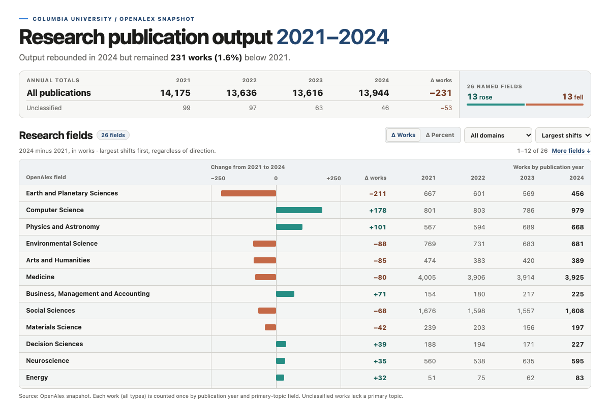
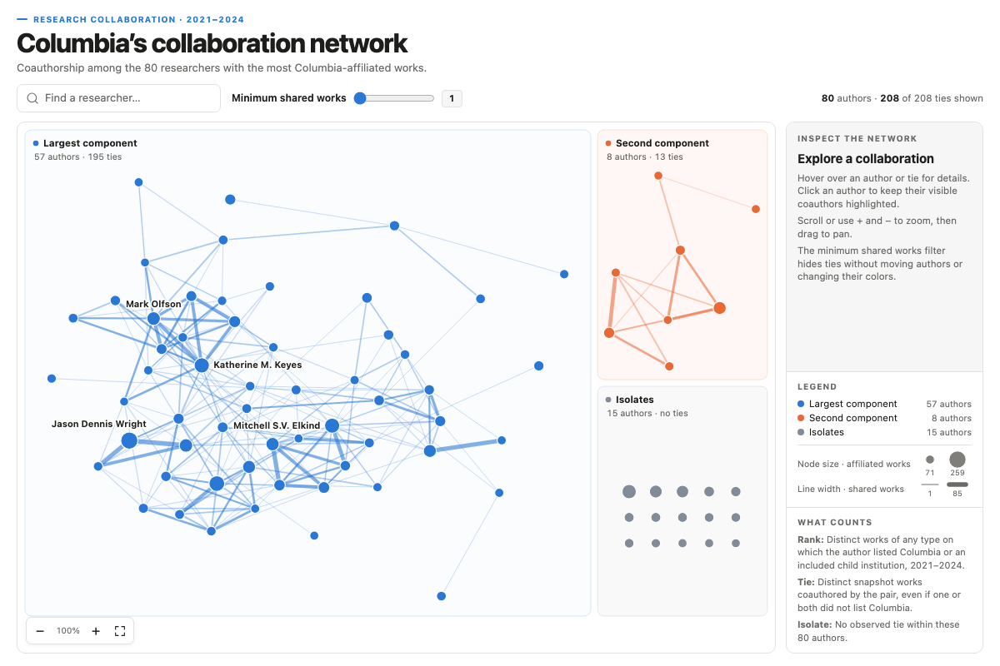
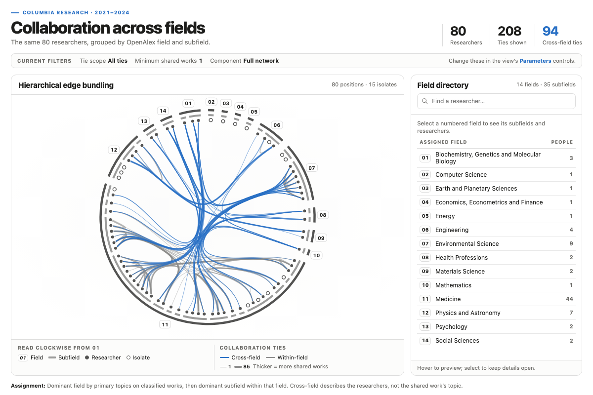

# M1 self-review: data and agent core (no UI)

_Date: 2026-11-23. Checked against PLAN §9._

## Exit criteria

| Criterion | Result | Evidence |
|---|---|---|
| The three demo questions run end-to-end in the CLI and produce approved visualizations | ✅ | Q1 → V1, Q2 → V1, Q3 → V3, all `approved`; screenshots and CLI logs in `docs/reviews/m1/` |
| The trace shows delegation and at least one gate round | ✅ | Every run delegates lead → data → (analyst) → viz. Q3 shows the full loop: V2 **rejected** by the Critic (interaction 3/5, "filters not discoverable"), revised, V3 **approved** (5/5/4/5). |
| Spend ≤ $15 | ✅ | Ledger total **$1.62** (spike $0.015; Q1 $0.37; Q2 $0.47; Q3 $1.24) |

## Demo results

| Run | Question | Agents involved | Gate | Time | Cost |
|---|---|---|---|---:|---:|
| Q1 | Publication output per field, 2021 → 2024 | lead, data, viz, critic | V1 pass (5/5/4/4) | 387 s | $0.37 |
| Q2 | Collaboration network of the 80 most prolific researchers, force-directed | lead, data, analyst, viz, critic | V1 pass (5/5/4/4) | 464 s | $0.47 |
| Q3 | Same network with hierarchical edge bundling by field/subfield (follow-up in the same session) | lead, data, analyst, viz, critic | V2 revise → V3 pass (5/5/4/5) | 690 s | $1.24 |

Critic scores are listed as answers_question / truthfulness / readability / interaction.

### What the runs show about the design

**Dynamic plans, not a fixed pipeline.**
- Q1 needed no Analyst step: lead → data → viz.
- Q2 and Q3 used the Analyst.
- Q3 reused the Q2 session's artifacts (the same 80 researchers, graph G1) and kept V1 for comparison.

**Discovery and generality.**
- Each view picked its own implementation:
  - Q1: hand-written SVG, no library.
  - Q2: `d3-force@3.0.0`, `d3-selection@3.0.0` and `d3-zoom@3.0.0`. The agent read the docs of `d3-force` and `d3-zoom` with `read_package_docs`.
  - Q3: the bundled layout was implemented without a library. The Viz agent prepared the hierarchy with Python (16 `run_python` calls).
- All imports were pinned automatically.
- The no-hardcoding test passes: prompts and harness contain no technique names.

**Grounded answers.** Every claim in the final answers cites artifacts. Examples: Q1 "[T1, T2]"; Q3 "94 of 208 ties (45%) cross field boundaries [F7, T8]".

**Interaction contract.** All three approved views passed the generic interaction tests:
- hover → details;
- click → selection with ids that exist in the data;
- visible selection and highlight;
- every declared parameter works (Q1: 3 params, Q2: 2, Q3: 3).

**Cost attribution.** Cost is tracked per agent. The Viz agent dominates:
- Q1: $0.26 of $0.37 (24 model calls);
- Q2 + Q3: $0.91 of $1.24 (77 model calls).

## Checklist

- [x] Exit criteria met, with evidence (above)
- [x] Unit tests pass (8), including the no-hardcoding lint test
- [x] Prompts and harness reviewed for technique-specific logic. Technique names appear only in the *user questions* used for the demos.
- [x] DEVLOG, DECISIONS (D26–D33) and STATUS updated
- [x] Spend vs budget: $1.62 / $50
- [x] Known issues listed below

## Known issues

| # | Issue | Severity | Plan |
|---|---|---|---|
| 1 | **Latency.** 6.5–11.5 min per question, against targets of ~1 min (simple) and ~3 min (complex). Causes: the Viz agent runs at high reasoning effort with many preview rounds (24–77 model calls), and the Data agent runs extra validation queries. | Medium for live use; low for the video, which uses replay | M2 options: Viz at medium effort with the escalation path as the safety net; cap preview rounds; stream progress and show drafts early in the UI. Parameter and highlight changes skip the Viz agent and stay fast. Needs the user's call. |
| 2 | The Q1 and Q2 views draw their own control widgets for declared parameters. This would duplicate host controls in the UI. | Low | Fixed for new runs: the Viz prompt says the host renders parameter controls, and the Critic is told so (D33). Q3's V3 already points users to "the view's Parameters controls". |
| 3 | Escalation to GPT-6.2 Astra was never triggered: no view failed 3 times. | Low | Add a unit test that forces the path (M2/M3). Acceptance criterion 5 needs it shown once. |
| 4 | Not yet exercised end-to-end: `ask_user` (the interrupt mechanism was verified in the spike), `set_view_params` / `highlight_view`, and the canvas `pick()` path. | Low | Covered by M2 UI work. |
| 5 | The Critic sees the default and after-click screenshots but not hover tooltips. | Low | Optional hover screenshot later. |
| 6 | Cosmetic: one artifact-saved event can print twice in the CLI. | Cosmetic | Ignore or fix in the M2 event pipeline. |

## Recommendation

Proceed to M2 (web app, interaction, replay). Before building the UI, decide on issue 1. Recommended: Viz at medium effort, Critic stays high, escalation stays on.
