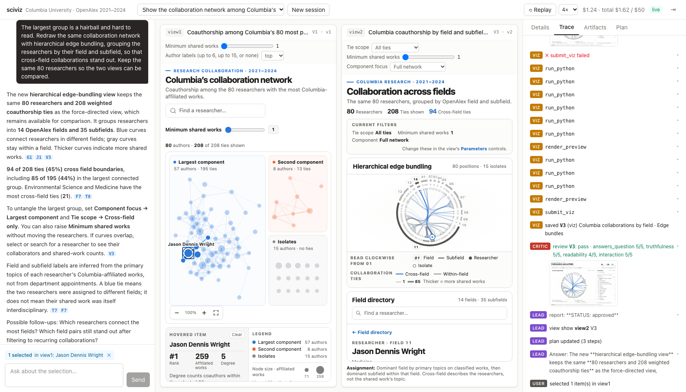
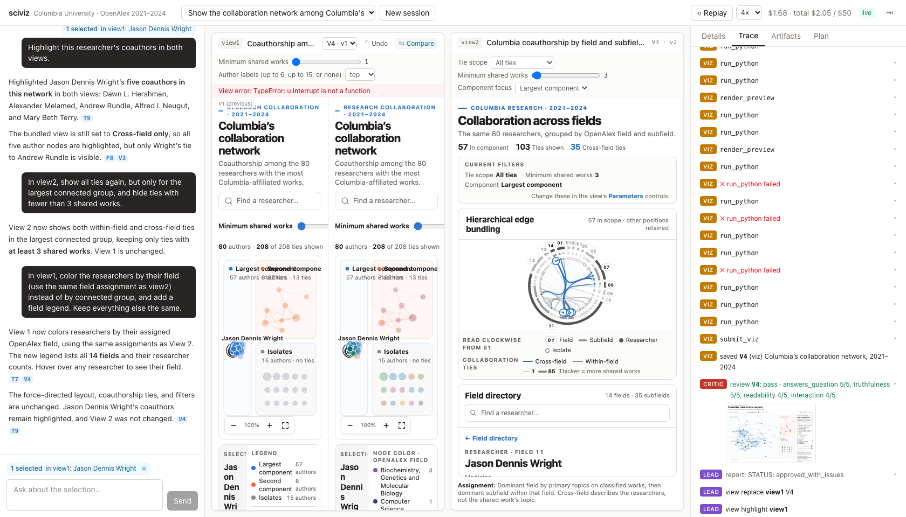

# M2 self-review: web application and interaction

_Date: 2026-11-23. Checked against PLAN §9._

## Exit criteria

| Criterion | Result | Evidence |
|---|---|---|
| In the browser: ask → see the view → hover, select, and ask with the selection | ✅ | `tests/ui/ui_smoke.py`: views render in sandboxed iframes, and clicking a node selects it in both views and shows the chat chip. A question typed in the UI was answered in 8 s and the view updated live (`ui_live_param.png`). |
| Each modification path works at least once | ✅ | Parameters: 4.7 s, $0.03. Highlight: 38.5 s, $0.07. Code edit + hot replace: 264 s, $0.34 (V4 replaced view1; V1 kept for undo/compare). See DEVLOG M2. |
| Two views linked | ✅ | Selecting Jason Dennis Wright (A5057686070) in the force-directed view selects him in the edge-bundling view (`linked_selection.png`). Highlights from the AI apply to both views. |
| A recorded session replays without an API key | ✅ | No-key server (`env -u OPENAI_API_KEY sciviz serve --port 8001`): `/api/health` → `live: false`; live questions → 503 with a clear message; `?replay=1&speed=16` rebuilds the session. Recording: `m2/m2_replay_demo.mp4`. |
| Cumulative spend ≤ $30 | ✅ | Ledger $2.09 (M2 ≈ $0.47) |

Also verified:
- clarifying-question interrupt: question → answer card → resume, 27 s;
- version switch, undo and compare (`compare_versions.png`);
- details-on-demand: dataset record plus the matching rows of the view's own data;
- trace with per-agent costs, briefs, gate verdicts and screenshots.

## Evidence

The video `m2/m2_replay_demo.mp4` (97 s) replays the whole network session at 16×:
- Q2 force-directed view;
- Q3 edge-bundling view, including the rejected V2;
- the highlight test;
- the parameter test;
- the code-edit test;
- then a click on a node.

## Checklist

- [x] Exit criteria met, with evidence
- [x] Tests: 9 unit tests pass, including the no-hardcoding lint and the gate retry → escalate → stop test
- [x] Prompts and harness reviewed: no technique-specific logic was added in M2. The new prompt text covers view replacement and item ids.
- [x] DEVLOG, DECISIONS (D34–D39) and STATUS updated
- [x] Spend: $2.09 / $50
- [x] Known issues listed below

## Known issues

| # | Issue | Severity | Plan |
|---|---|---|---|
| 1 | Views built in M1 have two problems: they carry their own copies of parameter widgets (the prompt has since been fixed), and V1/V4 throw `u.interrupt is not a function` when state is restored. The UI shows this as a "View error" banner while the view still renders. | Low (legacy) | The hardened gate (D38) now rejects such views. For M3, the demo sessions will be regenerated from scratch with the current prompts and gate. |
| 2 | The Claude desktop browser pane blocks iframes, so the views do not render there. Regular browsers are fine. | Info | Use your own Chrome or Safari at http://localhost:5173. UI tests run in our own headless Chromium. |
| 3 | Live escalation to Astra has still not been triggered by a real failure. | Low | The state machine is unit-tested (`tests/test_gate_escalation.py`). A live occurrence is likely in M3's 4-task evaluation; otherwise it will be forced once for the video. |
| 4 | New full questions at medium Viz effort have not been timed yet. The code-edit path took 264 s (Q3 took 690 s at high effort). | Medium | Measured in M3. Parameter and highlight changes take seconds. |
| 5 | Browser views need internet access for CDN libraries (D35). | Low | Documented. |

## Recommendation

Proceed to M3:
1. Regenerate the demo sessions with the current gate and prompts.
2. Run the 4-task evaluation, including the single-agent comparison if the budget allows.
3. Write the README.
4. Make the TTS video.
5. Push to GitHub after your OK.
